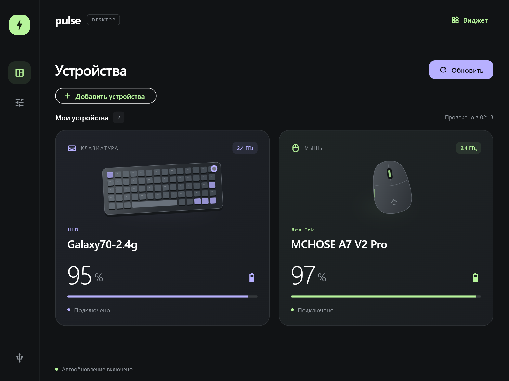
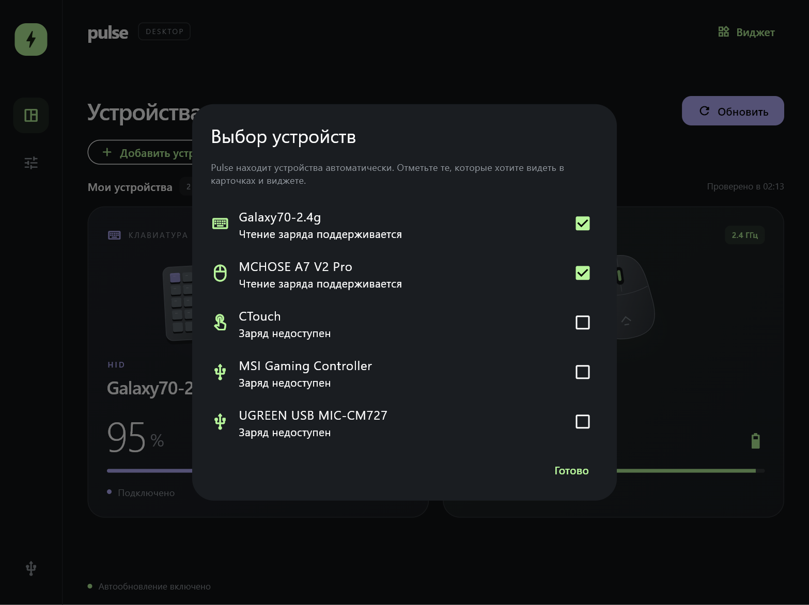
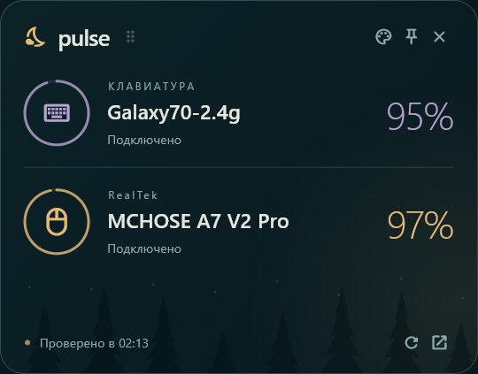

# Pulse

Приложение для Windows на Flutter: заряд беспроводной периферии, автоматическое обнаружение HID-устройств и компактный виджет на рабочем столе.

**Устройства обнаруживаются автоматически, а в карточки добавляются только по вашему выбору.**

## Скриншоты

Главное окно:



Выбор обнаруженных устройств:



Виджет на рабочем столе:



Снимки получены из работающего Windows-приложения с реальными данными устройств. Проценты и статусы зависят от их состояния в момент съёмки; демонстрационные значения не подставляются.

## Возможности

- Автоматическое обнаружение подключения и отключения HID-устройств.
- Выбор устройств через **«Добавить устройства»**; сохранение выбора после перезапуска.
- Объединение нескольких HID-интерфейсов одного устройства в одну карточку.
- Общий список выбранных устройств в главном окне, виджете и трее.
- Прокрутка списка в виджете, перетаскивание, закрепление поверх окон и четыре темы оформления.
- Проверка заряда вручную и по таймеру: 30, 60, 120 или 300 секунд.
- Уведомления о заряде 20% и ниже для выбранных устройств.
- Автозагрузка после входа в Windows и работа в трее.
- Диагностика подключения с копированием отчёта.

## Поддерживаемые устройства

| Устройство | Чтение заряда |
| --- | --- |
| MCHOSE A7 V2 Pro | USB-ресивер 2.4 ГГц; процент и состояние зарядки |
| Epomaker Galaxy70 | USB-ресивер `Galaxy70-2.4g`; процент заряда |
| Другие доступные HID-устройства | Обнаружение и карточки; «Заряд недоступен», если протокол модели не поддерживается |

Обнаружение не означает поддержку батареи. Универсальное чтение заряда Bluetooth-устройств и проводного режима не реализовано. Pulse не отправляет неизвестным моделям команды опроса батареи.

Несколько интерфейсов объединяются по Windows ContainerId. Без серийного номера смена USB-порта иногда меняет идентификатор — тогда устройство нужно выбрать заново.

## Сборка и запуск

### Что нужно

- Windows 11 x64 — платформа, на которой приложение проверено.
- [Flutter SDK](https://docs.flutter.dev/install/windows) с Dart 3.12.2 или новее. Проверено с Flutter 3.44.8.
- [Visual Studio 2022](https://visualstudio.microsoft.com/downloads/) с компонентом **Desktop development with C++** и Windows SDK. Одного VS Code недостаточно.
- Git; команды `git` и `flutter` должны быть доступны в терминале.

Проверьте окружение:

```powershell
flutter doctor -v
```

### Получить исходники и собрать

В PowerShell:

```powershell
git clone https://github.com/youngboy04/pulse-battery.git
cd pulse-battery
.\tools\build.ps1
```

Скрипт устанавливает Dart-зависимости, собирает Flutter-приложение и нативный помощник `pulse_hid.exe`. Если Flutter выбирает неподходящую установку Visual Studio, скрипт пробует установленную VS 2022 через CMake.

При корректно настроенном Flutter можно собрать напрямую:

```powershell
flutter pub get
flutter build windows --release
```

Запуск собранного приложения:

```powershell
.\build\windows\x64\runner\Release\pulse_battery.exe
```

Для разработки:

```powershell
flutter run -d windows
```

### Portable-папка и архив

После сборки:

```powershell
.\tools\package.ps1
```

Результат:

- `dist/Pulse/pulse_battery.exe` — приложение с нужными библиотеками рядом.
- `dist/Pulse-Windows-x64.zip` — архив для переноса на другой компьютер.

Распакуйте **весь архив** и запустите `Pulse/pulse_battery.exe`. Нельзя переносить только EXE: нужны `pulse_hid.exe`, DLL и каталог `data`. Flutter и Visual Studio на компьютере, где запускается готовая portable-сборка, не нужны.

Сборки и архивы не хранятся в Git. `Start Pulse.cmd` запускает локальную portable-сборку из `dist/Pulse`.

## Первый запуск

1. Подключите устройства или их USB-ресиверы.
2. Нажмите **«Добавить устройства»** и отметьте нужные. Список обновляется автоматически.
3. Нажмите **«Готово»**. Карточки появятся в главном окне, виджете и трее.
4. Кнопка **«Виджет»** открывает компактное окно. Перетаскивайте его за заголовок; булавка закрепляет поверх остальных окон, палитра меняет тему.
5. В настройках при желании включите **«Запускать вместе с Windows»**.

Чтобы убрать устройство, снова откройте «Добавить устройства» и снимите галочку. Повторное подключение не добавит его обратно без вашего выбора.

Крестик главного окна скрывает Pulse в трей. Для полного завершения выберите **«Выход»** в меню значка трея. Левый щелчок по значку открывает компактную панель, двойной — главное окно.

## Настройки и автозагрузка

- Выбранные устройства, интервал и уведомления: `%LOCALAPPDATA%\Pulse\settings.json`.
- Тема, положение, закрепление и видимость виджета: `HKCU\Software\Pulse`.
- Автозагрузка: запись `Pulse` в `HKCU\Software\Microsoft\Windows\CurrentVersion\Run`.

Автозагрузка открывает приложение в трее, без главного окна, и восстанавливает виджет по сохранённой настройке. Если перенесли portable-папку, заново включите автозагрузку в настройках.

Поддерживаются параметры запуска:

```powershell
.\pulse_battery.exe --enable-startup
.\pulse_battery.exe --disable-startup
.\pulse_battery.exe --startup-status
.\pulse_battery.exe --startup
.\pulse_battery.exe --widget
.\pulse_battery.exe --exit
```

`--startup-status` возвращает код 0, если автозагрузка указывает на текущий EXE, и 1 в противном случае.

## Если заряд не появился

Разбудите мышь или клавиатуру, проверьте режим 2.4 ГГц, закройте фирменный конфигуратор и нажмите «Обновить». Другая программа может занимать ресивер.

- «Заряд недоступен» означает, что устройство обнаружено, но его протокол батареи не поддерживается.
- При сне или отключении последнее измерение отмечается как устаревшее. Проценты хранятся только в текущем сеансе; выбор устройств сохраняется между запусками.
- Наличие USB-ресивера не означает, что сама беспроводная мышь включена.
- Ресивер может возвращать закэшированный заряд. Pulse показывает время получения ответа, поскольку возраст измерения на стороне устройства неизвестен.
- У Galaxy70 состояние зарядки по кабелю неизвестно; нулевой ответ считается отсутствием достоверного измерения. Для MCHOSE настоящий 0% поддерживается.

## Проверки

```powershell
flutter analyze
flutter test
.\build\windows\x64\native\Release\protocol_test.exe
```

Тесты проверяют обнаружение, объединение интерфейсов, выбор и сохранение устройств, переподключение, обработку ответов и интерфейс. Golden-тесты используют Segoe UI на Windows; другая версия шрифта может влиять на сравнение изображений. Изображения в `test/goldens` — тестовые эталоны, а не снимки для README.

## Структура

- `lib/` — интерфейс Flutter, список устройств, настройки и фоновое обновление.
- `native/` — перечисление HID-интерфейсов, поддерживаемые протоколы батареи и их тесты.
- `windows/runner/` — окна Windows, трей, события подключения и автозагрузка.
- `test/` — Dart- и widget-тесты.
- `tools/` — сборка, упаковка, проверка окон и создание снимков интерфейса.
- `docs/` — [описание протоколов](docs/protocols.md) и [обновление скриншотов](docs/screenshots/README.md).

Репозиторий самодостаточный: соседние проекты и дополнительные локальные пакеты не нужны.
